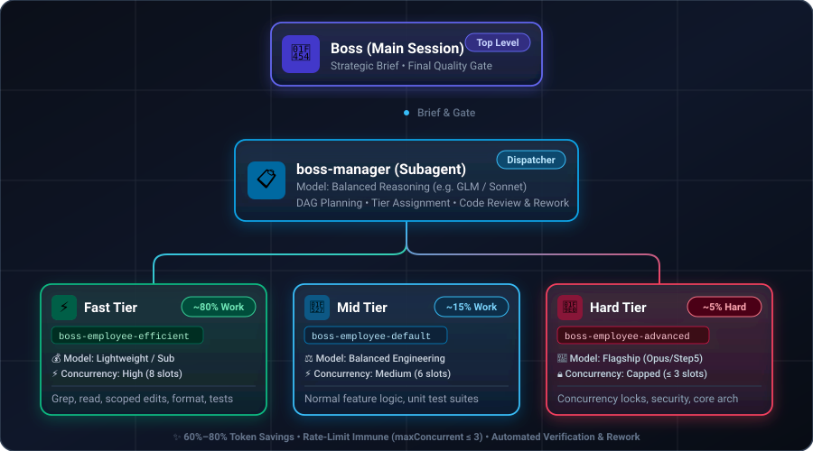
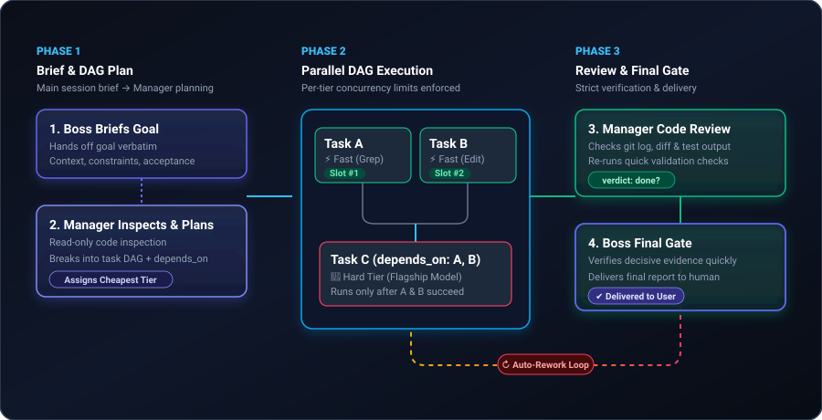

<div align="center">

# 🏢 Boss

### Hierarchical Multi-Agent Delegation for Claude Code

**Near 2-Level (2L) Quality at a Fraction of the Token Cost**

[](LICENSE)
[](https://docs.anthropic.com/en/docs/claude-code)
[]()
[]()

<br/>

**[English](README.md)** | **[简体中文](README.zh-CN.md)** | **[日本語](README.ja.md)**

<br/>

<p align="center">
  
</p>

</div>

---

## 💡 The Core Value: Why 3-Tier beats 2-Tier in Cost-Efficiency

> 💡 **Core Trade-off**: *"Our 3-tier architecture might not beat an all-flagship 2-level setup in raw peak firepower, but it slashes your token bill by 60–80% while reaching remarkably close delivery quality."*

In typical multi-agent frameworks, **2-Level architectures** (Boss directly dispatching a fleet of flagship models) hit two painful walls:
1. **Astronomical Token Bills**: Running Claude Opus or Sonnet at maximum effort just to grep code, read files, or format boilerplate is tremendous waste.
2. **Rate Limit Blowouts (429s)**: Spawning multiple top-tier models simultaneously consumes interactive quota in minutes, triggering long cooldowns.

| Metric | Traditional 2-Level (2L: Boss → Fleet) | 🏢 Boss 3-Level (Boss → Manager → Tiers) |
|:---|:---|:---|
| **Model Allocation** | All flagship models (Opus/Sonnet) for every subtask | **Task-tailored**: Manager uses balanced reasoning; 80% routine work uses cheap models; top-tier models only for hard blockers |
| **Token Cost** | 💸 **Extremely High** | 💰 **Up to 70% Cheaper** |
| **Rate Limit Risk** | ⚠️ High (Parallel flagship models trigger 429 quickly) | 🛡️ **Safe** (`maxConcurrent ≤ 3` for top tiers, high concurrency for cheap tiers) |
| **Delivery Quality** | 🌟 100% Upper Bound | 🎯 **~90%+ Near Quality** (Achieved via Manager review, DAG dependencies, & auto-rework) |

---

## 🎯 Architecture & Roles

| Role | Who | Responsibility |
|:---:|:---:|:---|
| **👔 Boss** | You (Main Session) | Hands off the high-level objective and conducts the final quality gate. |
| **📋 Manager** | Subagent (`boss-manager`) | Reads codebase, decomposes tasks into DAG, assigns employee tiers, reviews results, issues rework. |
| **🛠️ Employees** | Subagents (`boss-employee-<tier>`) | Execute scoped tasks at their assigned tier, self-verify with tests/commands, and report back. |

---

## ✨ Features

- 🎯 **Tiered Model Routing** — 3 configurable tiers (`efficient`, `default`, `advanced`), routing the majority of mechanical tasks to lightweight models.
- 🔀 **Dual Modes**:
  - **Workflow Mode (Default)**: Deterministic DAG execution via `boss.workflow.js`. Strict slot-based concurrency and structured loop.
  - **Subagent Mode**: Free-form orchestration where the manager dispatches employees via autonomous `Agent` calls.
- 🔄 **Automated Review & Rework Loop** — The manager independently inspects repo diffs and test output. Unsatisfactory work is sent back for rework automatically (up to `maxRounds`).
- 🧩 **DAG Task Chaining** — Tasks declare `depends_on`. Independent branches run concurrently; dependent tasks wait for prerequisites.
- 🔒 **Concurrency & Quota Guard** — Per-tier `maxConcurrent` limits prevent quota exhaustion on rate-limited models.
- ⚙️ **Zero Hassle Configuration** — Edit `boss.json` anytime; models and tiers sync automatically.

---

## 🚀 Quick Start

### 1. Clean Installation (Zero Bloat)

Install only the essential runtime files into `~/.claude/skills/boss` (without polluting your config folder with `.git`, documentation, or images):

**macOS / Linux / Git Bash (Recommended One-Liner):**
```bash
curl -fsSL https://raw.githubusercontent.com/wray-lee/boss/master/install.sh | bash
```

**Windows (PowerShell):**
```powershell
irm https://raw.githubusercontent.com/wray-lee/boss/master/install.ps1 | iex
```

<details>
<summary><b>Or install locally via Python / Git</b></summary>

```bash
git clone https://github.com/wray-lee/boss.git
cd boss && python install.py
```
</details>

Then reload plugins inside Claude Code (or restart your session):

```
/reload-plugins
```

> 💡 **Silent Auto-Sync**: Agent definitions in `~/.claude/agents/` are registered automatically. If you modify `boss.json` in the future, the skill auto-syncs on your next `/boss` invocation.

### 2. Usage

```bash
# Workflow Mode (Default — deterministic DAG + strict cost control)
/boss Refactor src/utils and add unit tests

# Subagent Mode (Manager orchestrates freely)
/boss subagent Investigate and resolve the root cause of issue #42
```

---

## ⚙️ Configuration (`boss.json`)

Configure models, tiers, effort, and concurrency in `boss.json`:

```jsonc
{
  "manager": {
    "model": "glm[1m]",        // Manager model: cost-effective reasoning
    "effort": "high"
  },
  "tiers": {
    "efficient": {              // Handles 80% of routine tasks
      "model": "sub[1m]",
      "effort": "high",
      "maxConcurrent": 8,
      "description": "Cheap and fast. Mechanical edits, searches, formatting, simple tests."
    },
    "default": {
      "model": "sub[1m]",
      "effort": "high",
      "maxConcurrent": 6,
      "description": "Normal engineering work. Scoped features, focused review, unit tests."
    },
    "advanced": {               // Hard problems only
      "model": "step5[1m]",
      "effort": "max",
      "maxConcurrent": 3,       // Strictly capped to prevent rate limits
      "description": "Hard problems. Concurrency, security, cross-module design."
    }
  },
  "maxRounds": 5                // Maximum plan → execute → review cycles
}
```

Whenever you update `boss.json`, the skill automatically re-syncs on your next `/boss` invocation, or you can optionally run:
```bash
python -I ~/.claude/skills/boss/sync_agents.py
```

---

## 📁 Repository Structure

```
boss/
├── SKILL.md              # Skill definition & protocol for the boss (main session)
├── boss.json             # Model, tier, effort, and concurrency config
├── boss.workflow.js      # Workflow mode: DAG runner, plan-execute-review loop
├── sync_agents.py        # Generates ~/.claude/agents/boss-*.md from boss.json
├── strip_agent_name.py   # PreToolUse hook preventing named agent stalls
├── LICENSE               # MIT License
├── assets/               # Architecture and workflow SVG diagrams
├── README.md             # English documentation
├── README.zh-CN.md       # 简体中文文档
└── README.ja.md          # 日本語ドキュメント
```

---

## 🔧 Workflow Lifecycle

<p align="center">
  
</p>

---

## 📝 Notes

- **Top-Tier Model Protection**: Keep flagship models (Opus / Fable / Astra) at `maxConcurrent ≤ 3` to avoid triggering Claude Pro 429 limits.
- **Custom Tiers**: Tier names are completely free-form. Add, rename, or adjust tiers directly in `boss.json`.
- **PreToolUse Hook**: `strip_agent_name.py` prevents the manager from creating named mailbox agents that fail to return results.

---

## 📄 License

Distributed under the [MIT License](LICENSE).

<div align="center">
<sub>Built for <a href="https://docs.anthropic.com/en/docs/claude-code">Claude Code</a> · Maximum token efficiency, uncompromising engineering quality 🚀</sub>
</div>
